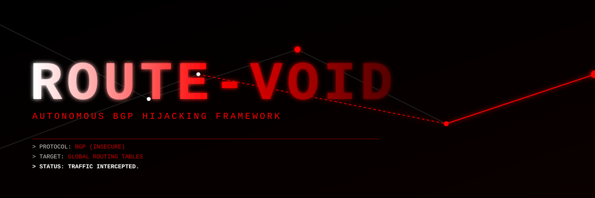

<div align="center">
  
  
  <h1> itROUTE-VOID</h1>
  <p><b to>THE INTERNET IS HELD TOGETHER BY TRUST. WE DESTROYED IT.</b></p>
  
  
  
  
</div>

---

## ☠️ WHAT IS ROUTE-VOID?

Most hackers try to break into servers. They spend months looking for SQL injections, zero-days in web servers, or kernel exploits. 

They are wasting their time.

The internet is not a secure network. It is a system built on blind trust. The backbone of the internet is controlled by **BGP (Border Gateway Protocol)**. BGP is the protocol that tells routers where to send packets. 

**BGP has zero built-in security.** If a router says "I am the fastest path to Binance," every other router on the planet will believe it.

**ROUTE-VOID** is an automated BGP Hijacking framework. It injects fake routing announcements into the global internet backbone, forcing traffic destined for specific IP ranges (like crypto exchanges, banks, or government servers) to route through your machine instead.

## ⚡ CORE CAPABILITIES

*   **Prefix Hijacking:** Announce ownership of IP blocks you don't own.
*   **Traffic Interception (MITM):** Route traffic through your server, decrypt it (if it's unencrypted or if you have the keys), and forward the real destination. The victim won't even notice a delay.
*   **BGP Poisoning:** Corrupt routing tables globally, causing massive outages or black holes for specific targets.
*   **Zero Dependencies:** Pure Rust implementation of the BGP state machine and TCP socket manipulation.

## 🧠 HOW IT WORKS (THE TECHNICAL FLEX)

1.  **Discovery:** Scans public BGP looking glasses and RouteViews to map the global topology.
2.  **Vulnerability Analysis:** Identifies upstream ISPs that do not use RPKI (Resource Public Key Infrastructure) or strict prefix filtering.
3.  **Injection:** Establishes a TCP session (port 179) with an unsecured BGP peer and sends a crafted `UPDATE` message.
4.  **Silence:** The global internet routes traffic to your IP. The target's real servers go silent.

## 📊 THREAT MATRIX

| Target | Traditional Attack | ROUTE-VOID Attack |
| :--- | :--- | :--- |
| **Binance** | Attempt to hack the web server. | **Hijack their /24 prefix. All API traffic goes to us.** |
| **AWS** | DDoS attack. | **Blackhole their BGP routes. AWS goes offline.** |
| **Elon Musk (Starlink)** | Hack the satellites. | **Hijack the BGP routes for the ground stations.** |

## 🛠️ EXECUTION

> ⚠️ **WARNING:** Injecting BGP routes affects the global internet. If you hijack a major prefix without proper filtering, you can cause a global outage. Use only in authorized environments or on your own AS.

```bash
# Clone the weapon
git clone https://github.com/vantacorehq/route-void.git

# Launch the hijacking sequence
sudo ./route-void --prefix 104.16.0.0/12 --asn 64500 --peer 192.0.2.1
